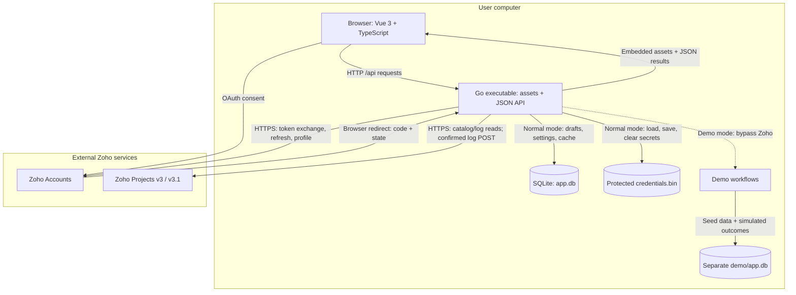
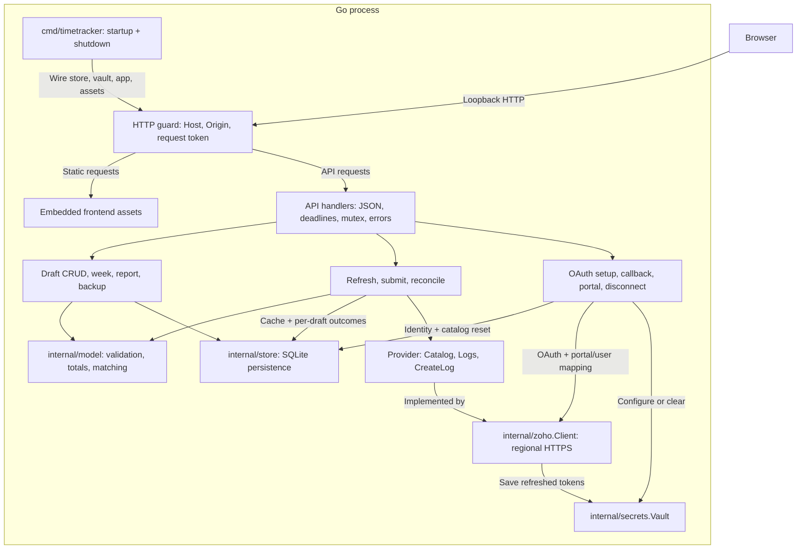
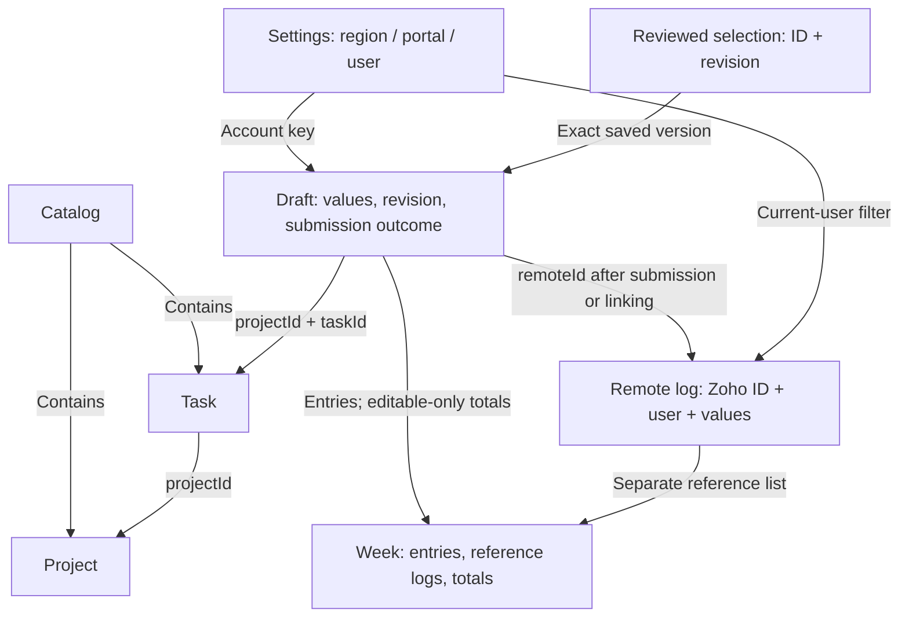
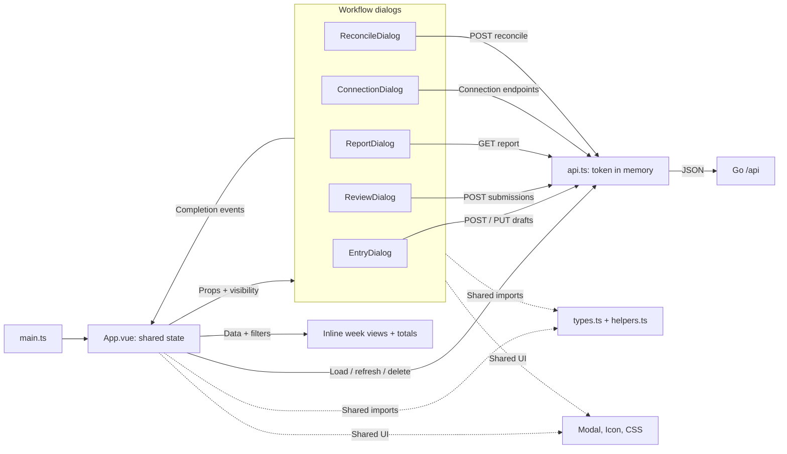
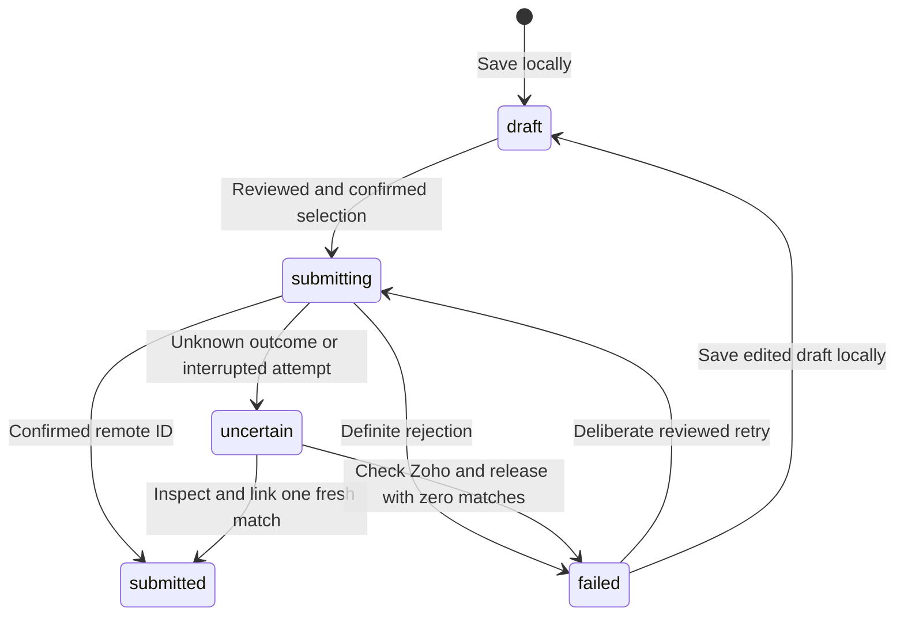

# Architecture diagrams

These diagrams describe the current Tempo implementation. Read them alongside the
[architecture notes](ARCHITECTURE.md), [requirements](REQUIREMENTS.md), and
[Zoho API contract](ZOHO.md).

- [Whole system](#whole-system): runtime boundaries and external data flows.
- [Backend](#backend): Go packages and workflow responsibilities.
- [Data relationships](#data-relationships): logical entities and physical storage.
- [Frontend](#frontend): Vue state, views, dialogs, and API calls.
- [Submission lifecycle](#submission-lifecycle): confirmed writes and uncertain results.

The Mermaid fences in this document are the editable source. Solid arrows show calls,
data flows, or labeled entity relationships; dashed arrows show supporting dependencies
or a mode-specific path. Subgraphs group responsibilities, not additional services.
Labels and arrow styles carry the meaning without relying on color.

## Whole system

Tempo runs for one user on their computer. In production, one Go executable serves
the built Vue assets and the same-origin JSON API on loopback. Go owns persistence,
OAuth token exchange/refresh, and all Zoho Projects requests. The browser visits
Zoho Accounts for consent and returns to the local callback.

Saving drafts, starting the app, refreshing reference data, and generating reports
never create a Zoho time log. Only an explicitly confirmed review submits selected
drafts. SQLite backups exclude credentials; report copying uses the browser clipboard.
Demo mode selects a separate `demo/` data directory and simulates submission locally.

During development, Vite serves Vue and proxies `/api` to Go at `127.0.0.1:8080`.
The production executable needs no Node runtime. Windows protects the credential
file with DPAPI; other platforms use a private file with mode `0600`.

Sources: [startup](../cmd/timetracker/main.go), [asset embedding](../web/assets.go),
[Vite proxy](../web/vite.config.ts), [HTTP boundary](../internal/app/http.go),
[workflows](../internal/app/app.go), and [Zoho adapter](../internal/zoho/client.go).

## Backend

The backend is a single Go process. HTTP handlers and application workflows share
the `internal/app` package; the diagram separates their responsibilities for clarity.
API handlers use a shared mutex and a two-minute request context deadline.

| Component | Responsibility |
| --- | --- |
| [Startup](../cmd/timetracker/main.go) | Choose real or demo storage, construct dependencies, bind `127.0.0.1`, serve embedded assets, and shut down on interruption. |
| [HTTP boundary](../internal/app/http.go) | Enforce loopback Host, allowed write Origin, and `X-App-Token`; limit and decode JSON; route requests; sanitize errors. |
| [Local workflows](../internal/app/app.go) | Save revision-checked drafts and build week responses; report/backup handlers live in `http.go`. |
| [Remote workflows](../internal/app/app.go) | Refresh catalog and week logs; validate the entire reviewed selection; persist each submission attempt and result; fetch fresh reconciliation candidates. Demo branches bypass the provider. |
| [Connection handlers](../internal/app/http.go) | Save credential configuration, validate expiring OAuth state and PKCE, select portal/user identity, and disconnect while keeping drafts. |
| [Domain model](../internal/model/model.go) | Validate dates, integer minutes, notes, account ownership, and project/task membership; calculate totals/reports and exact reconciliation matches. |
| [Store](../internal/store/store.go) | Persist JSON records in SQLite, enforce revisions, replace a fetched log range atomically, create consistent backups, and recover interrupted submissions as uncertain. |
| [Zoho adapter](../internal/zoho/client.go) | Implement the provider contract; handle regional hosts, pagination, exact IDs/durations, token refresh, rate-limit cooldown, bounded HTTP requests, and sanitized failures. |
| [Vault](../internal/secrets/vault.go) | Load, save, and clear credentials separately from SQLite. Secrets stay out of API responses and backups. |

Only the Zoho adapter knows external payload names and regional endpoints. Its HTTP
client has a 30-second timeout and honors the request context. The
[Zoho contract](ZOHO.md) records endpoints and failure behavior.

## Data relationships

These are **logical domain entities**, not a diagram of SQL tables or enforced
foreign keys. IDs are strings, dates are `YYYY-MM-DD`, and durations are integer
minutes. Settings identify one region, portal, and user; drafts retain this account
key so another connected account cannot submit them.

| Physical storage | Contents |
| --- | --- |
| SQLite `meta(key, value)` | Settings and catalog as JSON values; demo also stores a seed marker. Projects and tasks are inside the catalog, not separate tables. |
| SQLite `drafts(id, date, revision, body)` | Draft JSON, including `status`, `attemptAt`, `error`, and optional `remoteId`. Submission results are stored on each draft, not in a separate results table. |
| SQLite `logs(id, date, body)` | Cached remote log JSON keyed by Zoho ID; refreshing replaces the requested date range in a transaction. |
| Separate `credentials.bin` | Client ID/secret, region, OAuth access/refresh tokens, and expiry. This is outside SQLite. |

A successful submission records the remote ID on the draft; it does not automatically
insert a cached remote log. Reference logs arrive through refresh. Week totals and
reports use only editable local drafts (`draft` and `failed`), excluding submitted,
submitting, uncertain, and remote reference entries. Names copied into drafts remain
available for historical display.

Sources: [domain types and calculations](../internal/model/model.go),
[storage schema and recovery](../internal/store/store.go), and
[credential types](../internal/secrets/vault.go).

## Frontend

Vue uses Composition API and `<script setup lang="ts">`. `App.vue` owns shared
`ref`/`computed` state and renders the week views inline; there is no router or
centralized store library. Dialogs receive props, keep local form state, and use
the shared API helper. Completion events let App reload the affected data.

| Source | State and behavior |
| --- | --- |
| [App.vue](../web/src/App.vue) | Owns bootstrap/week data, week navigation, filters/search, view/dialog selection, loading/errors, and toast feedback. Visible totals count editable drafts; daily bars and project breakdown also derive from local drafts. |
| [EntryDialog](../web/src/components/EntryDialog.vue) | Add, edit, or duplicate a draft; filter tasks by project; parse duration into whole minutes; emit `saved`. |
| [ReviewDialog](../web/src/components/ReviewDialog.vue) | Select visible editable drafts, total the selection, require the confirmation checkbox, then send saved IDs/revisions and emit `submitted` with the result summary. |
| [ReportDialog](../web/src/components/ReportDialog.vue) | Fetch the server-generated project/week text, protect against stale responses, preview, and copy to the clipboard. It emits `close`, not a data-change event. |
| [ConnectionDialog](../web/src/components/ConnectionDialog.vue) | Enter credential configuration transiently, navigate to the returned OAuth consent URL, list/select portals, and disconnect; emit `changed`. |
| [ReconcileDialog](../web/src/components/ReconcileDialog.vue) | Check fresh candidates for an uncertain draft; require user acknowledgment before linking or releasing; emit `changed`. |
| [API helper](../web/src/api.ts), [types](../web/src/types.ts), [helpers](../web/src/helpers.ts) | Fetch JSON using `X-App-Token` held in module memory; define payload interfaces and shared date/duration/editability helpers. Runtime validation remains on Go. |
| [Modal](../web/src/components/Modal.vue), [Icon](../web/src/components/Icon.vue), [CSS](../web/src/style.css) | Provide dialog focus/keyboard behavior, SVG icons, and responsive presentation. |

Credentials entered during setup are sent to Go and are not persisted in browser
storage. App downloads backups directly from `GET /api/backup`; ReportDialog uses
the clipboard, and ConnectionDialog navigates the browser for OAuth consent.
The dialog event arrow summarizes mutation events; all dialogs also support closing.

## Submission lifecycle

Saving is local. ReviewDialog requires an explicit confirmation before sending
selected draft IDs and revisions. Go validates the whole selection before any
provider call, then persists `submitting` and the attempt time before each POST.
Each remote result is recorded independently; one failure does not erase another
entry's success.

`submitted` is read-only. `uncertain` cannot be edited, deleted, or submitted again.
Transport errors, HTTP 5xx/408, malformed success responses, missing remote IDs,
and interrupted attempts remain uncertain. Startup recovers persisted `submitting`
entries to `uncertain`; it never retries their POSTs.

Reconciliation fetches fresh logs and matches user, task, date, minutes, billing
flag, notes, and the attempt window, excluding already-linked IDs. Linking requires
one fresh matching log and explicit inspection. Release requires zero matches and
the user's direct check in Zoho. Multiple matches stay locked. Releasing only makes
the draft editable for a later reviewed retry; it does not submit it.

Sources: [review confirmation](../web/src/components/ReviewDialog.vue),
[submission workflow](../internal/app/app.go), [reconciliation handler](../internal/app/http.go),
[matching](../internal/model/model.go), [startup recovery](../internal/store/store.go),
and [provider failure classification](../internal/zoho/client.go).

## Maintaining and verifying these diagrams

Edit the Mermaid fences here, keep labels concise, and update the linked source
references when responsibilities change. Use established `flowchart` and
`stateDiagram-v2` syntax so GitHub can render the source without generated images.
Do not add secrets, company records, or real OAuth payloads as examples.

Check the diagrams against the implementation, verify all relative links, and
preview every fence with a Mermaid renderer. Inspect labels/arrows at normal size
and check that the meaning remains clear without color. GitHub's Mermaid renderer
can differ from other renderers: verify the Markdown in GitHub's preview before
merging and record the exact evidence in [validation](VALIDATION.md).
